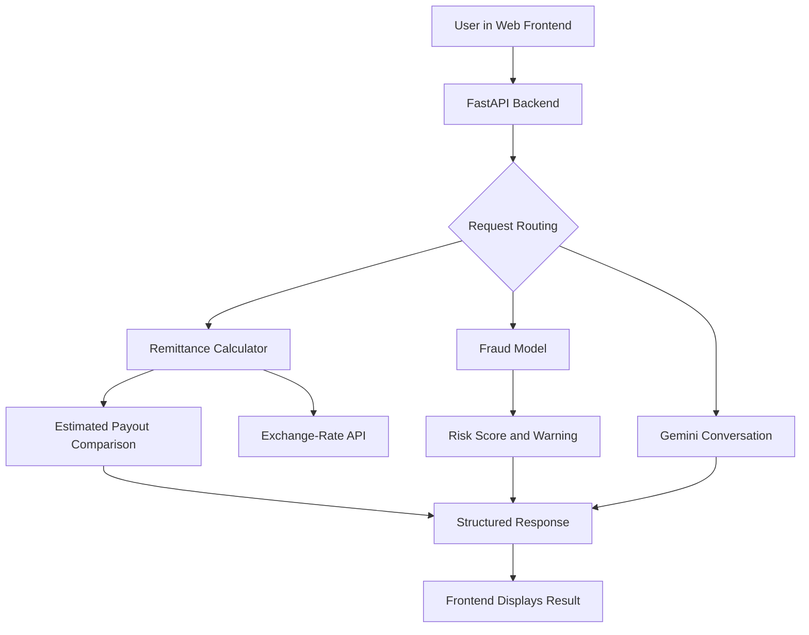

# FundGuide AI 
### AI-Assisted Cross-Border Remittance Guidance and Transaction-Risk Flagging

[](https://www.python.org/)
[](https://fastapi.tiangolo.com/)
[](https://scikit-learn.org/)
[](https://fintechathon.g-ican.com/)

**Competition:** [2026 Shenzhen International FinTech Competition (FinTechathon)](https://fintechathon.g-ican.com/)  
**Track:** C — Cross-border & Student Finance Assistant

> FundGuide AI is a prototype financial-guidance assistant that estimates remittance payouts, compares configurable transfer-cost assumptions, and flags transaction patterns that a machine-learning model considers suspicious. It combines deterministic Python calculations with a conversational AI interface so financial arithmetic is not left to the language model.

---

## Table of Contents
- [Overview](#overview)
- [The Problem](#the-problem)
- [Features](#features)
- [How It Works](#how-it-works)
- [Technology Stack](#technology-stack)
- [Machine Learning](#machine-learning)
- [API Reference](#api-reference)
- [Run Locally](#run-locally)
- [Project Structure](#project-structure)
- [Limitations and Responsible Use](#limitations-and-responsible-use)
- [Roadmap](#roadmap)
- [Team](#team)

## Overview

FundGuide AI is designed to help Bangladeshi students and their families better understand cross-border money transfers. Remittance costs can be difficult to compare because fees, exchange rates, and payout conditions differ between services. Users may also want a plain-language explanation of transaction patterns that deserve extra scrutiny.

FundGuide brings these tasks into one conversational interface. It estimates recipient payouts using a Python calculation engine, retrieves a USD-to-BDT reference exchange rate, provides a model-based transaction-risk score, and uses Google Gemini to explain results in English, Bangla, or Banglish.

## The Problem

A transfer's advertised fee alone does not show how much money a recipient will receive. The exchange rate and other charges can materially affect the final payout. Separately, users may benefit from understandable warnings when a transaction resembles patterns identified by a fraud-screening model.

FundGuide AI aims to make these estimates and warnings easier to understand. It is an advisory prototype, not a remittance provider or a replacement for a bank's fraud-prevention systems.

## Features

###  Remittance payout comparison
- Estimates the recipient payout in Bangladeshi taka (BDT) for a given USD amount.
- Compares configured provider assumptions for Wise, bKash, and bank transfer.
- Calculates estimated payouts using a deterministic Python formula.
- Shows the difference between the highest and lowest estimated payouts (the project's “Family Impact” comparison).

**Important:** Provider fees, rate adjustments, and delivery estimates currently configured in code are illustrative assumptions, not verified live quotes from each provider. Treat the results as estimates.

###  Machine-learning transaction-risk flagging
- Uses a Random Forest classifier trained on selected records from the synthetic PaySim mobile-money dataset.
- Applies SMOTE to the training partition to address class imbalance.
- Returns a model-based risk score for supported transaction inputs.
- Displays a warning in the interface when the configured risk threshold is met.

A high score is a signal to review transaction details, not proof that a transaction is fraudulent. Model performance on synthetic PaySim data does not establish performance on real remittance transactions.

###  Bilingual conversational assistant
- Integrates Google Gemini for conversational explanations.
- The prompt asks the model to respond in English, Bengali script, or Banglish according to the user's message.
- Uses backend calculation outputs to support financial explanations rather than relying on the language model to perform the arithmetic.

###  Exchange-rate fallback
- Requests a USD exchange-rate feed from Open ER API.
- Uses a configured fallback rate if the external request fails.
- The backend marks the fallback status as stale so the interface can communicate that the rate may not be current.

###  Web interface and API
- A conversational frontend displays responses, payout guidance, and transaction-risk warnings.
- FastAPI exposes backend routes and interactive API documentation through Swagger UI.

## How It Works



1. **User request:** The user enters a question or transfer details in the web interface.
2. **Request routing:** FastAPI selects the relevant calculation, fraud-check, or conversational path.
3. **Deterministic calculations:** The remittance module applies configured fee and rate assumptions to estimate payouts.
4. **Risk inference:** The fraud module prepares a feature vector and obtains a prediction from the saved Random Forest model.
5. **Explanation:** Gemini generates a conversational explanation where applicable.
6. **Frontend response:** The interface displays the returned text, structured results, and any risk warning.

The language model is used for explanation and conversation. Arithmetic and model inference are handled by backend Python code.

## Technology Stack

| Component | Technology |
|---|---|
| Backend API | Python, FastAPI, Uvicorn |
| Conversational AI | Google GenAI SDK, Gemini |
| Machine learning | Scikit-learn, Random Forest |
| Imbalanced-data handling | imbalanced-learn, SMOTE |
| Data processing | pandas |
| Model persistence | joblib |
| HTTP requests | requests |
| Configuration | python-dotenv |
| Exchange-rate source | Open ER API |
| Frontend | Lovable-generated web interface |
| Hosting | Render is reported as the backend host; verify the current deployment before relying on the link |

## Machine Learning

### Dataset and training pipeline

The training script uses a local PaySim CSV file and selects the first 300,000 rows before filtering for `TRANSFER` and `CASH_OUT` transaction types. The target is `isFraud`.

The model uses these six features, in the order expected by the training code:

1. Transaction type (`TRANSFER` or `CASH_OUT`, encoded numerically)
2. Transaction amount
3. Sender's balance before the transaction (`oldbalanceOrg`)
4. Sender's balance after the transaction (`newbalanceOrig`)
5. Recipient's balance before the transaction (`oldbalanceDest`)
6. Recipient's balance after the transaction (`newbalanceDest`)

The training script splits the selected data into training and test partitions, applies SMOTE to the training partition, trains a Random Forest classifier, prints a classification report, and saves the fitted model to `fraud_model.pkl`.

### Interpreting the risk score

The interface's percentage represents a model output for the supplied feature values. Unless probability calibration and appropriate validation have been performed, it should not be interpreted as a calibrated real-world probability of fraud.

PaySim is synthetic mobile-money data. The model is a prototype screening component and has not been established as a production-ready fraud detector for international remittances.

### Evaluation status

The training script prints a classification report. Add and publish additional metrics—such as precision, recall, F1-score, ROC-AUC, and a confusion matrix—only after running and recording those evaluations on an untouched test set. Do not infer accuracy from a single example shown in the interface.

## API Reference

When the backend is running locally, open:

- **Swagger UI:** [`http://127.0.0.1:8000/docs`](http://127.0.0.1:8000/docs)
- **OpenAPI schema:** [`http://127.0.0.1:8000/openapi.json`](http://127.0.0.1:8000/openapi.json)

The current backend source defines these routes:

| Method | Endpoint | Purpose |
|---|---|---|
| `GET` | `/` | Basic API status response |
| `POST` | `/chat` | Conversational assistant and routed guidance |
| `POST` | `/check-fraud` | Dedicated transaction-risk check |

Check the deployed Swagger UI for the exact request fields and response schemas for the current version.

**Hosted API:** [https://fundguide-ai.onrender.com/docs](https://fundguide-ai.onrender.com/docs)  
*Verify that this deployment is active before publishing this link.*

## Run Locally

### Prerequisites
- Python 3.10 or a compatible version
- Git
- A Google Gemini API key
- Project files, including the trained model and the dataset if retraining

### 1. Clone the repository


```bash
git clone https://github.com/sadika-dotcom/FundGuide-AI.git
cd FundGuide-AI
```


### 2. Create and activate a virtual environment

**Windows (PowerShell):**
```powershell
python -m venv .venv
.venv\Scripts\Activate.ps1
```

**macOS / Linux:**
```bash
python3 -m venv .venv
source .venv/bin/activate
```

### 3. Install dependencies

```bash
python -m pip install --upgrade pip
pip install -r requirements.txt
```

### 4. Configure environment variables

Create a `.env` file in the project root:

```env
GEMINI_API_KEY=your_api_key_here
```

Keep your real API key private. Do not commit `.env` or paste secrets into issues, screenshots, or public documentation. Confirm that `.env` is listed in `.gitignore`.

### 5. Start the backend

```bash
uvicorn main:app --reload
```

The local API should be available at `http://127.0.0.1:8000`. Open the Swagger UI link above to inspect and try the available endpoints.

### Notes
- The fraud endpoint loads the saved model file. Ensure `fraud_model.pkl` is present at the path expected by `main.py`.
- Retraining requires the PaySim CSV file at the path expected by `train_fraud.py`. The dataset may need to be obtained separately; do not assume it is included in the repository.
- The backend alone does not start the separate web frontend. Follow the frontend project's own setup instructions if running the UI locally.
- If the exchange-rate service is unavailable, the backend may return a fallback rate marked as stale.

## Project Structure

The backend repository currently includes the following core files:

```text
FinPilot-AI/
├── main.py              # FastAPI routes, request handling, fraud inference, Gemini
├── calculator.py        # Exchange-rate retrieval and payout comparison
├── train_fraud.py       # PaySim preprocessing and Random Forest training
├── fraud_model.pkl      # Saved trained model
├── requirements.txt     # Python dependencies
└── .gitignore           # Files excluded from version control, if present
```

The exact file list may change. Add the frontend folder here if the frontend source is brought into this repository.

## Limitations and Responsible Use

- **Estimates, not quotes:** Provider fees and rate adjustments are configurable assumptions unless verified against current provider data.
- **Model-based warnings:** A risk score is not proof of fraud and should not be the sole basis for a financial decision.
- **Synthetic training data:** PaySim performance does not establish real-world remittance performance.
- **No money movement:** FundGuide AI does not execute transfers or access bank accounts in the inspected backend.
- **Rate freshness:** A fallback rate may be stale. Users should check the displayed status and verify current rates before making a transfer.
- **No guarantee of security:** The project is a prototype and has not been presented here as independently security-audited or production-certified.
- **Privacy:** Avoid entering real account credentials or unnecessary sensitive information into a prototype. Confirm frontend, hosting, logging, and retention behaviour before making data-retention claims.

## Roadmap

- [ ] Correct and test transaction-type encoding consistently between training and inference.
- [ ] Add unit and integration tests for calculations, model inputs, API failure handling, and frontend responses.
- [ ] Evaluate the fraud model with precision, recall, F1-score, ROC-AUC, confusion matrix, and threshold analysis.
- [ ] Investigate probability calibration before describing model scores as probabilities of real-world fraud.
- [ ] Make provider fee/rate assumptions and rate timestamps explicit in the UI.
- [ ] Implement persistent rate alerts and notification delivery before describing alerts as fully operational.
- [ ] Restrict CORS to approved frontend origins for production.
- [ ] Align the product name, repository URL, API title, frontend branding, and documentation.
- [ ] Add screenshots and reproducible test results to the competition submission.

## Team

- **Sadika Sharif** — Team Lead & AI Engineer
- **[Tazryanbinte Kashem]** — UI/UX Designer & Security Lead
- **[Ariba Siddiqua]** — Product Strategist & Lead Presenter


---

## Disclaimer

FundGuide AI is an educational and competition prototype that provides estimates and model-generated risk signals. It is not financial, legal, or banking advice, and it does not guarantee exchange rates, payout amounts, delivery times, or fraud detection outcomes. Verify fees and rates with the relevant provider before making a transfer.
